# Lab: XORPUF

**By:** Nathaniel Wagner

**Date:** 2026/3/13

**Last Modified: 2026/11/11

**Status:** Complete. May be expanded in the future.

## Overview and Operation

In the context of hardware security, Physical Uncloneable Functions (PUFs) are circuits that take advantage of natural defects in the semiconductor manufacturing process to produce reliable, but hard to predict results that are unique to that specific chip. This means that it functions as a fingerprint for the specific semiconductor device, allowing it to be identified throughout the supply chain. PUFs can also be used as "Hardware Roots of Trust" for Secure Boot processes (ensuring devices aren't turned on loading malicious firmware and/or software).

The goal of this lab was to implement an architecture of PUF known as an Arbiter PUF, which works by sending a signal through parallel multiplexor chains. These chains form two racing paths. The signals propagating along these paths are swapped whenever a multiplexor is activated. This is determined by a "challenge" of n-bits corresponding to the number of multiplexor pairs. In theory, the two signals propagate through the chains at the same speed. In practice, the aforementioned manufacturing defects cause one signal to arrive before the other. The winner of this race determines the response, a 1-bit output. With enough Challenge-Response pairs, a specific semiconductor device can be identified.

For this specific lab and implementing the PUF on the FPGA board, operation is simple. After programming the FPGA, flipping Switch 9 on and then off will reset the board. The device automatically delivers 255 unique challenges to its Arbiter PUF, and then 255 responses are displayed on the 16x16 LED display. This display forms the fingerprint, allowing you to distinguish a specific DE1-SoC from other DE1-SoCs.

## Block Diagram

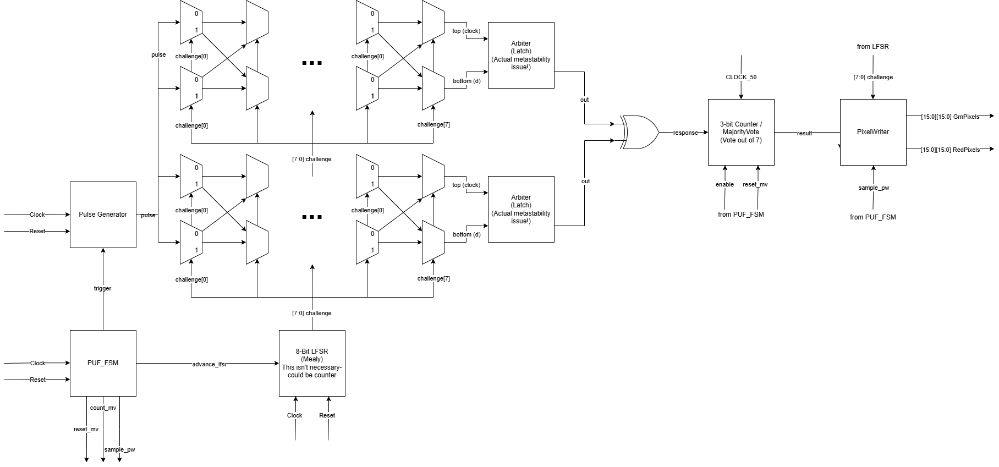

The timing of the system is coordinated by `PUF_FSM`, which runs a cycle to generate 255 (00000000 is not challenged) Challenge-Response Pairs that are then displayed on the 16x16 LED display.

1. `PUF_FSM` enables `LFSR` to generate a challenge.
2. The challenge is delivered to the `muxChain` to determine the four racing paths across two `ArbiterPUF`s.
3. `PUF_FSM` triggers the `pulseGenerator`, which starts the signal that propagates through the two `muxChain`s.
4. The signals reach their respective `Arbiter`, which decides the winner of each of the two races and releases a 1-bit response declaring the winner.
5. The two generated responses are XORed together, then delivered to the `MajorityVote` module — at its core, a 3-bit counter.
6. This process repeats an additional 6 times, resulting in 7 responses being recorded by the counter.
7. `MajorityVote` outputs the average of these responses, and when `PixelWriter` is enabled, it takes this average response and writes it to an LED in the display at the coordinate corresponding to the challenge.

## Module Descriptions

### Arbiter

The Arbiter is a latch that decides which of its two inputs arrived first, then outputs a 1-bit response representing the winner.

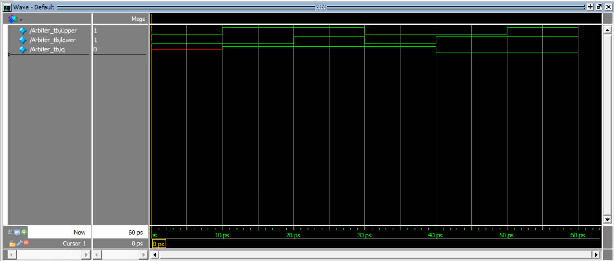

This simulation shows the latch behaviour of the Arbiter. Fed two inputs, it will output 1 if upper is high, and 0 if lower is high. Once an input signal generates an output, the output does not change, regardless of the other input, until the first input signal returns to low.

### pulseGenerator

Generates a pulse of a single clock period from an input that can be sustained for multiple clock cycles.

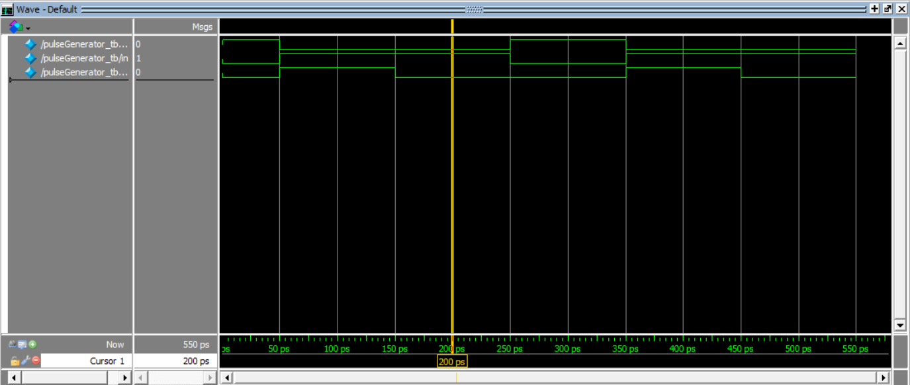

This simulation shows that regardless of the length of time for which the input signal of the `pulseGenerator` is held high, the output will only be held high for one clock signal.

### muxStage

A pair of 2:1 multiplexors, one described as being of a "top" layer and the other from the "bottom." Combined, they receive two inputs from the previous stage, one from the top and one from the bottom. When deactivated, they output their respective input signal. When activated, the bottom outputs the top input and the top outputs the bottom input.

### muxChain

This module chains together 8 `muxStage`s, taking a single input and outputting two signals. In theory, this should be a "do-nothing machine" since the outputs are simply the inputs.

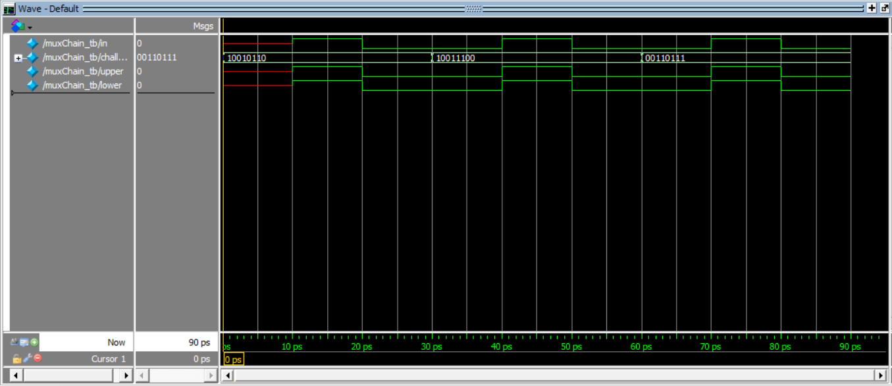

This simulation shows the "do-nothing" behaviour of the `muxChain`. Regardless of the challenge given, the outputs, `upper` and `lower`, always match the input, `in`, in theory. This behaviour is what changes in practice.

### ArbiterPUF

A mid-level module that puts an input into the `muxChain`, then passes on the two `muxChain` outputs to the `Arbiter` to produce a final 1-bit response. This module shares the same trivial behaviour as the `muxChain` in simulation.

### XORPUF

This simple mid-level module instantiates two `ArbiterPUF`s and a `pulseGenerator`. It passes the output of the `pulseGenerator` into the two `ArbiterPUF`s, producing two responses, then XORs these outputs together to produce a singular 1-bit response. This module shares the same trivial behaviour as the `muxChain` in simulation.

### LFSR

An 8-bit Linear Feedback Shift Register used to generate 255 challenges to feed into the PUFs. (00000000 is not tested since it is a trap state for the LFSR.) In this implementation, it's not necessary for this module to be pseudorandom, since the challenge bit size is small enough that it's possible to test every challenge. However, it's quite common for PUFs to have upwards of 64-bit challenges, which would be achieved by extending the mux chain. For this reason, the LFSR was chosen for its scalability: if the design continues to iterate, it may be the case where the challenge width is extended and a random subset of hundreds of thousands of possible challenges needs to be tested.

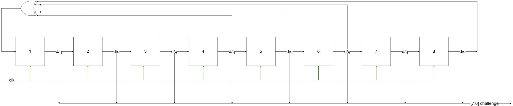

Diagram of the LFSR showing the result of the 4th, 5th, 6th, and 8th flip-flops being XORed together to produce a feeding bit that allows the LFSR to reach 255 of its 256 possible states.

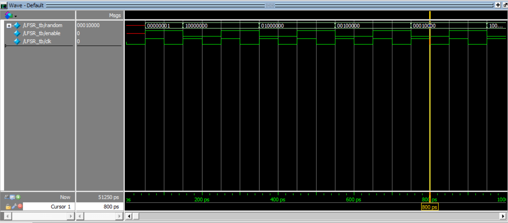

This simulation shows the LFSR changing states with the enable signal.

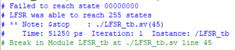

Since it's difficult to visually confirm that the LFSR is visiting every possible state, the test bench was given the additional functionality of recording each state visited.

As shown, out of 256 possible states of the LFSR, the only state not visited is 00000000, which is a trap state for the 8-bit LFSR. Since it was an unnecessary complication to have the LFSR visit the trap state and then find a way to permit it to leave, the 00000000 challenge simply wasn't used in the implementation.

### PUF_FSM

This module orchestrates challenging the PUF and recording its responses. The FSM runs for a finite amount of time, with transitions governed by the clock and two counters.

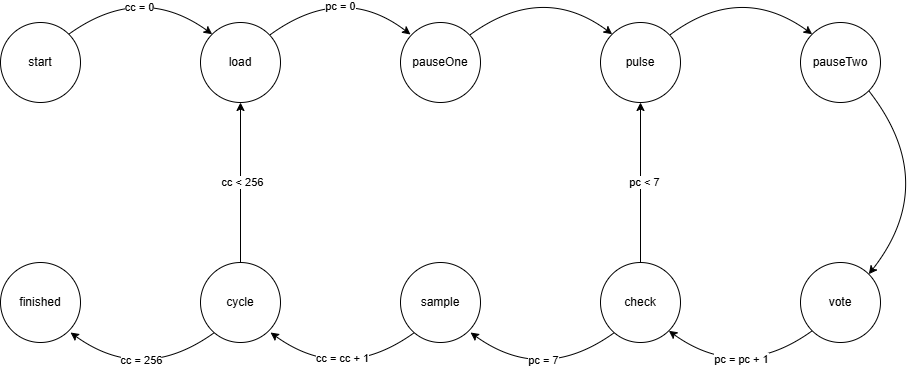

Its steps:

1. Start with a pause, giving the system time to reset. Set a challenge counter to 0.
2. Load a unique challenge from the LFSR into the PUF. The FSM sends the enable signal to LFSR. Set a pulse counter to 0.
3. Pause to let the challenge propagate.
4. Pulse a signal through the PUF. The FSM sends a trigger to the Pulse Generator.
5. Pause to let the pulse propagate.
6. Vote: the FSM sends an enable signal to `MajorityVote` to count the response from the Arbiter. Increment pulse counter by 1.
7. Check to see if the pulse has been delivered with the same challenge seven times over. If not, repeat steps 4–7.
8. Sample the `MajorityVote`: the FSM sends an enable signal to `PixelWriter` to sample the output of `MajorityVote`. Increment challenge counter by 1.
9. Cycle steps 2–9 if fewer than 256 challenges have been tested with the PUF.
10. Finished when 256 challenges have been tested, with each challenge tested 7 times and the most frequent result recorded.

> \*Since the LFSR doesn't generate 256 bits, this cycle simply means that a challenge gets overwritten. This quirk is left untouched, since the LFSR is treated as an implementation detail rather than an essential design decision.

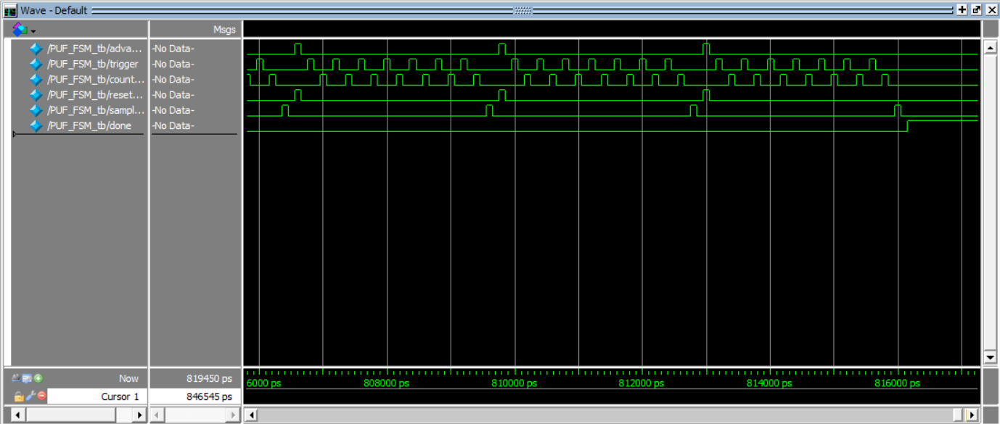

This simulation shows the cycling of the FSM. The top `advance_lfsr` signal goes high when a new challenge is being loaded during the load state. Seven successive high-low switches for both the `trigger` and `count_mv` signals correspond to the pulse and vote states. After each cycle, `sample_pw` goes high followed quickly by `reset_mv`, corresponding to `PixelWriter` taking the average response from `MajorityVote` before `MajorityVote` resets its counter. Finally, once 256 challenges have been tested, the `done` signal is raised high to signal that the FSM is finished.

### MajorityVote

`MajorityVote` is a 3-bit counter that counts the responses of `XORPUF`. It outputs the average response across 7 trials.

The MajorityVote is governed by simple Moore machine logic. It counts up from 0 to 7, each value represented by a state. In states 0–3, the output is 0. In states 4–7, the output is 1.

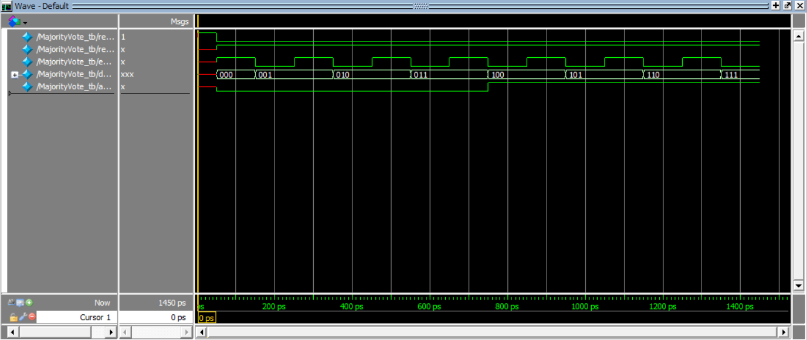

This simulation shows the incrementing of `MajorityVote`. After reset, `response` is held high (a low response doesn't contribute to count). Enable is then toggled on and off to command `MajorityVote` to add the response to its total count, resulting in an increment by 1. The output, `average`, starts low and turns high once count reaches 4, indicating the majority of responses are 1's.

### PixelWriter

`PixelWriter` takes the average response generated by `MajorityVote` and writes it to a coordinate of the 16x16 LED display, using the challenge from the LFSR as a coordinate where (x, y) = (challenge[7:4], challenge[3:0]). It writes a 1 to the `GrnPixels` array of the `LEDDriver` module when the response is a 1, and writes to the `RedPixels` array when the response is a 0.

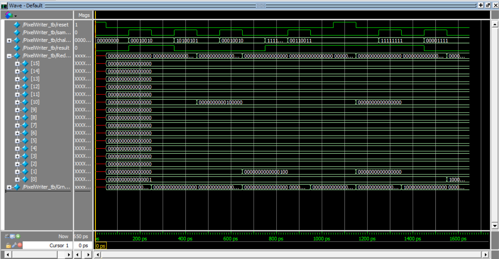

Simulation that shows the result in the RedPixels array.

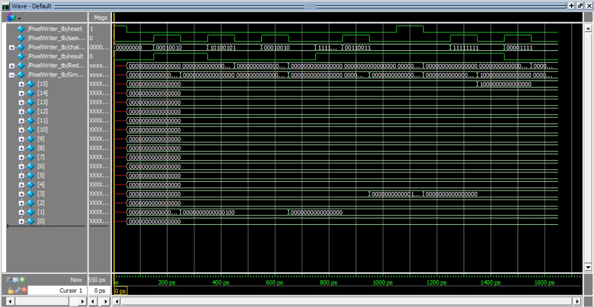

GrnPixels output shown above.

This simulation shows the behavior of the `PixelWriter` module. The `sample_pw` signal goes high for exactly one clock cycle to trigger a pixel write, during which the `challenge` input selects the target pixel by splitting into a row and column coordinate. The `result` input determines the color written: high result drives `GrnPixels` high at that address while keeping `RedPixels` low, and a low result does the opposite. When `reset` goes high, all pixel registers are cleared to zero in the same clock cycle. Outside of a `sample_pw` pulse or reset, both `RedPixels` and `GrnPixels` hold their values indefinitely regardless of changes to `challenge` or `result`. This takes up space on the board as flip-flops but could be moved to RAM if space were a concern.

### DE1-SoC

This is the top-level module that instantiates all of the mid-level modules. It turns off the 7-segment displays, connects the reset to Switch 9, and connects the outputs of the `LEDDriver` to the GPIO pins on the DE1-SoC.

## Testing

Beyond the test benches, 16 challenges that tend to produce a lot of varied responses between PUFs were fed into 7 different boards, recording the responses. This allowed determination of the bias of the PUF (how often it responds 1 as opposed to 0) and the uniqueness of the PUF (how often responses differ from other PUFs). Initial low uniqueness caused an expansion of the ArbiterPUF architecture to a XORPUF. A XORPUF XORs the outputs of two ArbiterPUFs. This tends to help uniqueness since only around 20–40% of challenges given to PUFs tend to produce varying responses, so the XORPUF enables taking advantage of the defects of two ArbiterPUFs to have a larger subset of possible differentiating challenges.

### Challenge-Response Table

| # | Challenge | My Response | Tyler's Response | Raiyan's Response | Naomi's Response | Board 1 Response | Board 2 Response | Board 3 Response |
|---|-----------|:---:|:---:|:---:|:---:|:---:|:---:|:---:|
| 1  | 00000000 | 1 | 1 | 1 | 1 | 1 | 1 | 1 |
| 2  | 11111111 | 0 | 1 | 0 | 1 | 0 | 1 | 1 |
| 3  | 10101010 | 0 | 0 | 0 | 0 | 0 | 0 | 0 |
| 4  | 01010101 | 0 | 0 | 0 | 0 | 0 | 0 | 0 |
| 5  | 00001111 | 1 | 1 | 1 | 1 | 1 | 1 | 1 |
| 6  | 11110000 | 0 | 1 | 0 | 1 | 0 | 1 | 1 |
| 7  | 00000001 | 1 | 1 | 1 | 1 | 1 | 1 | 1 |
| 8  | 10000000 | 0 | 0 | 0 | 0 | 0 | 0 | 0 |
| 9  | 00000011 | 1 | 0 | 1 | 0 | 1 | 1 | 1 |
| 10 | 11000000 | 1 | 1 | 1 | 1 | 1 | 1 | 1 |
| 11 | 00111100 | 1 | 1 | 1 | 1 | 1 | 1 | 1 |
| 12 | 11000011 | 1 | 1 | 1 | 1 | 1 | 1 | 0 |
| 13 | 01111111 | 0 | 0 | 0 | 0 | 0 | 0 | 0 |
| 14 | 11111110 | 0 | 1 | 0 | 0 | 0 | 1 | 0 |
| 15 | 00100100 | 1 | 1 | 1 | 1 | 1 | 1 | 1 |
| 16 | 01001001 | 1 | 0 | 0 | 0 | 1 | 1 | 1 |

**Bias:** 0.5625, 0.625, 0.5, 0.5625, 0.5625, 0.75, 0.625

*(Columns correspond, in order, to: My Response, Tyler's Response, Raiyan's Response, Naomi's Response, Board 1 Response, Board 2 Response, Board 3 Response.)*

## Features

The Quartus Synthesizer optimizes your circuit and the Fitter places it at a location on the FPGA board that it finds appropriate. For the purposes of a PUF, we want to regulate this behaviour. As mentioned before, the `muxChain` is a "do-nothing" machine — its outputs appear to always be its inputs. To prevent the synthesizer from optimizing away the chain, convenient SystemVerilog structures that beget optimization, such as a for-loop, had to be avoided. This is why each pair of muxes is instantiated by a generate loop.

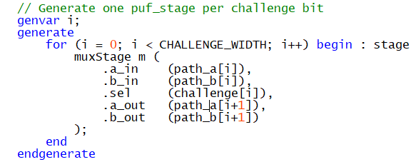

At the mux level, the structure is kept using the SystemVerilog `keep` keyword.

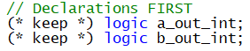

Regulating the Fitter's behaviour was a little more involved. After first compiling the design for the Arbiter PUF, the Chip Designer tool in Quartus was used to see where circuit elements were being placed on the board. The muxes need to be placed precisely in parallel so that the signal in either branch takes a comparable amount of time to propagate. This avoids extreme bias, whereby a PUF will almost always output the same response. The difference in responses should be caused by the manufacturing defects on the board, not a difference in routing. To solve this, several physical constraints were added to the Quartus Prime Settings file (`.qsf`), which determines entity-level assignments.

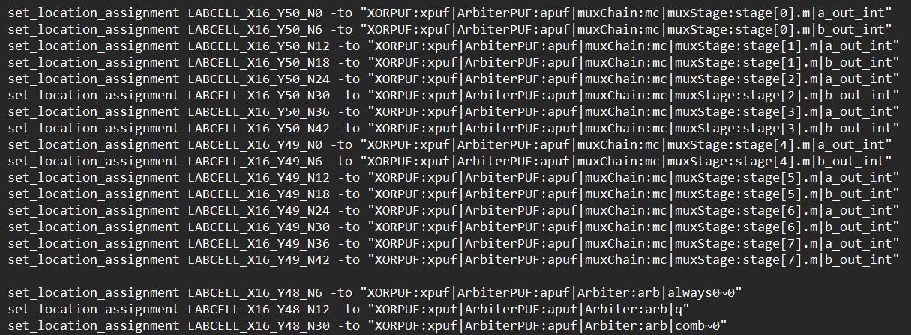

The constraints placed on one of the ArbiterPUFs, determining placement of the mux chains and the arbiter.

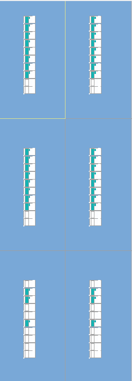

This is how the XOR Arbiter looks in the chip planner. The left and right cell columns represent the two distinct Arbiter PUFs. The top two rows represent the mux chains, and the bottom row represents the arbiters.

